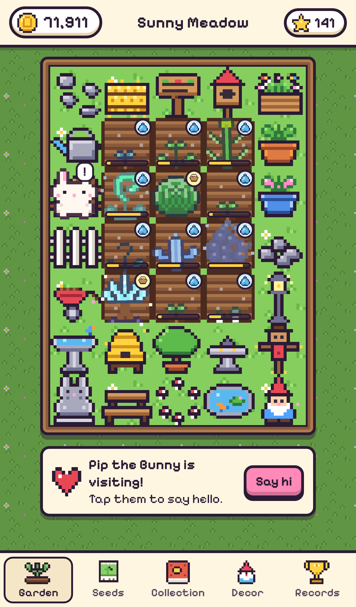
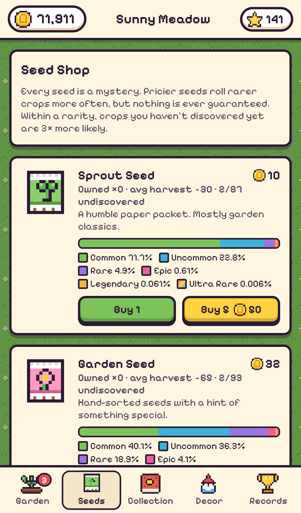
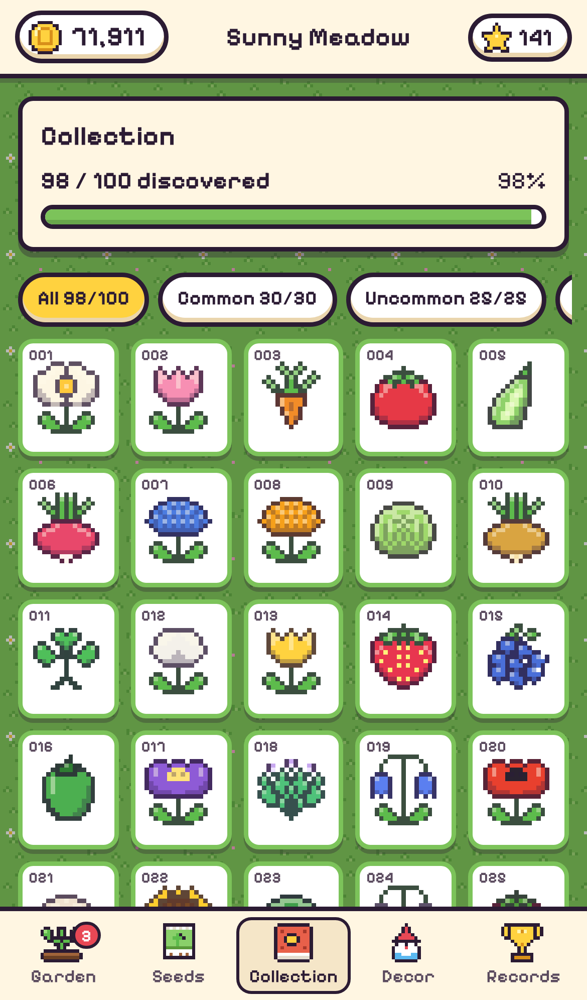
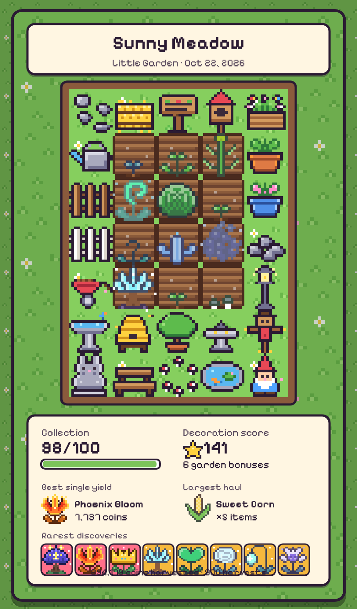

# Little Garden 🌱

A cute pixel-art idle gardening and collection game. Plant mystery seeds, watch them grow over real hours (even while the app is closed), water them at checkpoints, harvest them for coins, and discover all **100 crops**, including **5 ultra-rares**. Decorate a persistent garden, earn randomized permanent bonuses, greet visiting critters, and share a showcase card of your garden.

It is a **Progressive Web App (PWA)**: plain HTML/CSS/JavaScript, with no build step and no dependencies. It runs in iPhone Safari, can be added to the Home Screen, works offline, and is hosted on GitHub Pages.

> **Honest note:** a PWA is not a native App Store app. Little Garden runs in Safari's web engine. You install it with **Share → Add to Home Screen**, not from the App Store. No native iOS build is included.

| Garden | Seeds | Collection | Showcase |
|---|---|---|---|
|  |  |  |  |

## How to play

1. **Buy seeds** in the Seed Shop. Seeds are the only consumable item and coins are the only currency.
2. **Tap an empty plot** and pick a seed. Planting tells you nothing about what will grow: the seed drops into the soil and a seedling pops up.
3. **Watch it grow** through 5 stages: seedling, small plant, medium plant, large plant and final form. Crops take 1–16 real hours. Growth is calculated from saved timestamps, so it continues while the app is closed. Each stage gives more clues: the plant's shape family, leaf colour, a hint of bud colour, and finally the real silhouette in unripe colours.
4. **Guess** what it is (optional). Open a growing plot and pick a crop you have already discovered. A correct guess adds a harvest bonus, and earlier guesses pay more.
5. **Water** at the three checkpoints (a 💧 bubble appears on the plot). Each watering multiplies the harvest value and speeds up growth. If you miss a window, you only lose that window's bonus. Crops never wilt.
6. **Harvest** when the basket bubble appears. You earn coins, the crop is added to your Collection, and your records may update. The first harvest of each ultra-rare also gives you a unique decoration.
7. **Decorate**: buy decorations and place them on the grass. Your garden score goes up, and score thresholds award random permanent bonuses.
8. **Visitors** drop by from time to time. Tap them for coins, a free seed, a watering, or faster growth.

## Game rules (exact numbers)

Every tuning value lives in `src/data/config.js`. Crops are listed in `src/data/crops.js`, decorations in `src/data/decorations.js`, and visitors in `src/data/visitors.js`.

### Seed tiers and odds

The game rolls a rarity first, using the tier's odds, then picks a crop of that rarity.

| Seed | Price | Common | Uncommon | Rare | Epic | Legendary | Ultra |
|---|---|---|---|---|---|---|---|
| Sprout | 10 | 72.445% | 23% | 4% | 0.5% | 0.05% | 0.005% |
| Garden | 32 | 42% | 38% | 16% | 3.47% | 0.5% | 0.03% |
| Heirloom | 95 | 14% | 35% | 36% | 13.08% | 1.8% | 0.12% |
| Starlight | 210 | — | 18% | 45% | 30.6% | 6% | 0.4% |
| Moonlit | 380 | — | — | 34% | 50% | 15% | 1% |

* Pricier seeds have a better expected harvest and more profit per seed. The return per coin spent goes down as the price goes up, so cheap seeds are still useful, especially for finding the commons that Starlight and Moonlit seeds never roll. A unit test enforces this balance.
* Some magical crops can only come from Garden-tier seeds or better (`minTier`).
* No seed guarantees an ultra-rare, and the game has no pity timer.

### Discovery bonus (no pity)

Within the rolled rarity, each eligible crop you have **never harvested** gets **3× weight**. Crops you already found keep weight 1. Duplicates stay possible, and the rarity roll itself never changes. Each crop's Collection page shows its exact base odds per seed tier.

### Watering

Each crop has 3 checkpoints, at 0%, 30% and 60% of its planned grow time. A checkpoint's window stays open until the next one opens, or until harvest. Each watering applies **×1.15 harvest value** (so 1.15, 1.32 and 1.52 for 1, 2 and 3 waterings) and **×0.95 grow time**. Watering all three adds one extra item to the harvest.

### Growth stages and guessing

| Stage | Grow progress | What you see |
|---|---|---|
| Seedling | 0–20% | A sprout in the crop's leaf colour. Mushrooms, crystals, cacti and water plants have their own seedlings |
| Small plant | 20–45% | The growth family's shape: flower, tall stalk, root, leafy, bush, vine, mushroom, crystal, cactus, tree, pod or water plant |
| Medium plant | 45–70% | A bigger family shape with a faint bud or fruit hint of the final colour |
| Large plant | 70–100% | The crop's real silhouette, washed in unripe greens |
| Final form | ready | The crop itself. Harvest it to add it to your collection |

You can only guess crops you've already discovered, and the Collection shows every discovered crop's five stages so you can learn them. The bonus for a correct guess depends on the stage when the guess was made: **+30%** at seedling or small, **+20%** at medium, **+10%** at large. Changing a guess re-locks it at the current stage, guessing closes once the crop blooms, and a wrong guess costs nothing. These values live in `src/data/config.js` (`GROWTH_STAGES`, `GUESS_BONUS`).

### Determinism and saves

At planting time, the game derives the crop, quantity and value variance from the save's seed plus a planting counter, then stores the result in the save right away. Refreshing cannot reroll a seed. Bonus awards and visitor gifts are seeded the same way.

### Decoration score and bonuses

* Only **placed** decorations count. Base score by rarity: common 3, uncommon 6, rare 12, epic 24, legendary 45, ultra-rare trophy 80.
* Each extra placed copy of the same decoration counts **×0.6** of the previous copy.
* Thresholds: **10, 25, 45, 70, 100, 140, 190, 250, 320, 400, 500, 620, 760, 900**. They are measured against your best score ever, so each one pays out once. Moving or storing decorations cannot farm or reroll bonuses. Decorations cannot be sold, so coins cannot loop back out of them.
* Each threshold awards one random bonus type, picked from the types that are not yet maxed:

| Bonus | Per stack | Max stacks | Max effect |
|---|---|---|---|
| Thrifty Gardener | seeds 4% cheaper | 5 | 20% |
| Green Thumb | crops grow 5% faster | 5 | 25% |
| Lucky Soil | rare-and-up odds ×1.08 (renormalised) | 5 | ×1.40 |
| Market Darling | harvests +5% coins | 5 | +25% |
| Welcoming Garden | visitors 20% more often | 4 | +80% |

  If every type is maxed, a threshold pays 500 coins instead. Each extra copy of a decoration costs 50% more than the last, which gives late-game coins somewhere to go.

### Visitors

One visitor at a time arrives every 25–70 minutes. Visitors come more often with the Welcoming Garden bonus and with a higher decoration score (up to +50%). If you're away, at most one visitor waits for you, so idle time can't stack visitors up. There are 11 visitor types. Rewards scale gently with decoration score, capped at ×4.

## Run it locally

You need [Node.js](https://nodejs.org) 18 or newer, but only for the dev server and the tests. The game itself has no dependencies.

```bash
npm start            # serves the game at http://localhost:8080/
npm test             # unit tests: rules, balance, saves, PWA files, sprites
npm run e2e          # full browser playthrough with Playwright (if installed)
npm run assets       # regenerate PWA icons + sprite sheets from the pixel data
npm run screenshots  # regenerate docs/screenshots from a simulated save
npm run sprites -- help   # art pipeline: export / import / remove / preview sprites
```

Any static file server works too, for example `python3 -m http.server`. Open the page over `http://localhost` or HTTPS so the service worker can register.

To test on your iPhone on the same Wi-Fi, run `npm start` and open `http://<your-computer-ip>:8080/` in Safari. Offline mode and Add to Home Screen need HTTPS, so use GitHub Pages for the full experience.

## Publish on GitHub Pages

The game uses only relative paths, so it works under a repository subpath such as `https://<user>.github.io/Garden-Game/`.

**Option A: GitHub Actions (included)**
1. Push the repository to GitHub, with the code on the `main` branch.
2. In the repo, go to **Settings → Pages → Build and deployment → Source** and choose **GitHub Actions**.
3. Each push to `main` runs the tests and then deploys (`.github/workflows/pages.yml`). Your URL appears in the workflow run and in Settings → Pages.

**Option B: Deploy from a branch**
1. Go to **Settings → Pages → Source** and choose **Deploy from a branch**.
2. Pick your branch and the `/ (root)` folder, then save. The site is static, and the `.nojekyll` file is already in place.

When you change any game file, bump `VERSION` in `sw.js` so installed copies pick up the update. If you add a file under `src/`, also add it to the `ASSETS` list in `sw.js`. A test checks that you did.

## Add it to your iPhone Home Screen

1. Open your GitHub Pages URL in **Safari**. It must be Safari for the full install.
2. Tap the **Share** button (the square with an arrow).
3. Scroll down and tap **Add to Home Screen**, then tap **Add**.
4. Launch **Little Garden** from the Home Screen. It opens full-screen, works offline after the first load, and respects the notch and the Home Indicator.

### Good to know (PWA limitations)

* Progress is saved in the browser's local storage on that device. A Home Screen app keeps storage separate from the Safari tab, so a game started in a Safari tab won't carry over to the Home Screen icon. Use **Records → Backup save** to copy a save code and paste it into the other copy to restore it.
* iOS may clear website data for sites that haven't been used for weeks, and that includes Home Screen web apps. Make occasional backups with **Records → Backup save**.
* The game has no push notifications and no cloud sync. Timers still run correctly while the app is closed, because growth is computed from timestamps when you come back.
* **Showcase → Share** uses the iOS share sheet when it's available. Otherwise, press and hold the image to save it to Photos.

## Project structure

```
index.html              App shell (safe-area aware, iOS PWA meta tags)
manifest.webmanifest    PWA manifest (relative start_url/scope)
sw.js                   Offline service worker (precache + versioned cache)
src/
  main.js               Boot, navigation, timer loop, service worker registration
  styles.css            Mobile-first styles and animations
  core/                 Pure game logic: rng.js (seeded RNG), state.js (save/migrate), game.js (rules)
  data/                 config.js (all tuning), crops.js (100 crops), decorations.js, visitors.js
  art/                  Pixel-art templates + palettes; sprites.js builds every sprite (PNG overrides first)
  ui/                   Screens (garden, seeds, collection, decor, records, showcase) and modals
assets/fonts/           Pixelify Sans (OFL), bundled for offline use
assets/art/             Your PNG sprite overrides + manifest.json (see art pipeline)
assets/sprites/         Generated sprite sheets (reference)
icons/                  Generated PWA icons
tests/                  node:test unit tests
tools/                  Dev server, PNG encoder, asset/screenshot generators, e2e playthrough
```

### The art pipeline: replacing sprites in bulk

Every sprite can be replaced by a PNG file in `assets/art/<kind>/<key>.png`, where the kind is `crops`, `decor`, `visitors` or `ui`. At startup the game loads everything listed in `assets/art/manifest.json` and uses it instead of the generated art. The service worker caches those files for offline play. Anything without an override keeps its generated sprite, so you can redo the art a few sprites at a time.

* **Frames** are square and laid out left to right. A crop file has **5 frames** (seedling, small, medium, large, final) or **1 frame** (final form only). With a single frame, the game generates the growing stages itself and derives the large stage from your art. Visitors take 1–2 frames (idle, blink). Decorations and UI sprites take 1.
* **Any size works**: 16, 24, 32, 48 px and so on. All frames in one file must share the same size. The game scales everything to fit the garden tiles with crisp pixels.

The `sprites` tool does the bulk work:

```bash
# start from the current art: export editable PNGs (2x = 32px canvases)
npm run sprites -- export --rarity ultra --scale 2
npm run sprites -- export --family fungus,crystal       # by growth family
npm run sprites -- export --kind decor --keys gnome,fountain

# bring in art from anywhere (painted, AI-generated, other tools), any size:
# downscales to pixel art, reduces colours, matches files to crops by name/number
npm run sprites -- import ~/new-art --size 32 --colors 20 --trim --key-bg

npm run sprites -- preview      # contact sheets with overrides → art-preview/
npm run sprites -- list         # what is overridden
npm run sprites -- check        # validate files + manifest (also run by npm test)
npm run sprites -- remove --keys velvet-rose   # back to generated art
```

To import crops, name each file by its crop key (`velvet-rose.png`) or number (`031.png`, `31-anything.png`). Give either a strip of 5 frames or separate files `<key>-s0.png` … `<key>-s4.png`. After adding files by hand, run `npm run sprites -- sync` to update the manifest. When you publish new art, bump `VERSION` in `sw.js` so installed copies refresh. Filters work with every command: `--kind`, `--keys`, `--ids 1,5,10-20`, `--rarity`, `--template`, `--family` and `--category`.

### The pixel-art system

All art is real pixel art defined as data. Each sprite is a grid of characters mapped to a small palette (`src/art/*Art.js`). At runtime the game draws every sprite onto a canvas with nearest-neighbour scaling, and the Node tools use the same data to export the PNG icons and sprite sheets. The 100 crops share about 40 hand-drawn silhouette templates. Each crop gets its own palette and effect, and the 5 ultra-rares have unique templates. Growth stages come from 12 growth-family templates (`src/art/growthArt.js`). Any sprite can be replaced with a PNG through the art pipeline above.

To **add or rebalance a crop**, edit its row in `src/data/crops.js`. The tests check that there are still exactly 100 crops, that 5 of them are ultra-rare, that each one looks distinct, and that every tier's odds are consistent.

## License

Code: MIT (see `LICENSE`). Font: Pixelify Sans, SIL Open Font License 1.1 (`assets/fonts/OFL.txt`).
